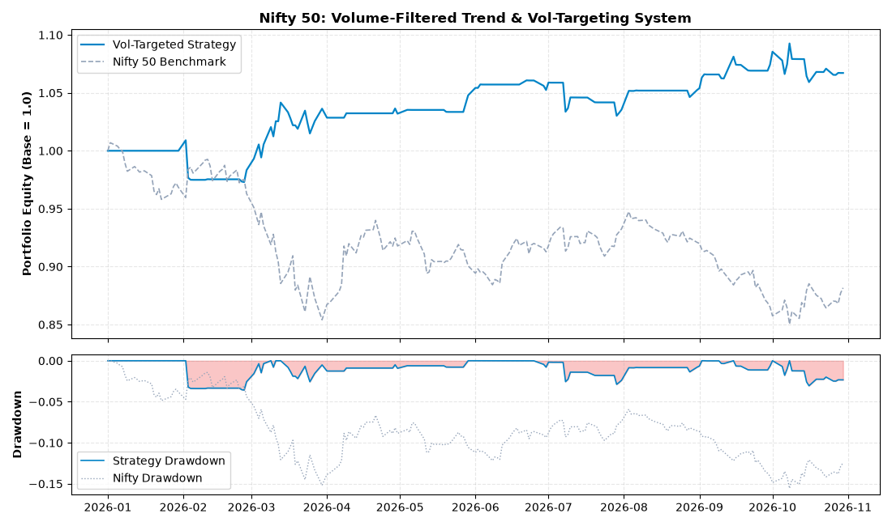

# Dual Moving Average Trend & Volatility-Targeted Risk Engine

A systematic, vector-based quantitative trading strategy and dynamic risk budgeting engine evaluated on the Nifty 50 Index (`^NSEI`). The model combines a volume-filtered dual exponential moving average (EMA) momentum core with inverse-realized-volatility position sizing to maintain a constant risk budget across market regimes.



---

## Performance Summary (2026 YTD Backtest)

| Metric | Strategy | Nifty 50 Benchmark |
| :--- | :--- | :--- |
| **Cumulative Return** | **+6.71%** | -11.83% |
| **Maximum Drawdown (MDD)** | **-3.58%** | -15.56% |
| **Annualized Sharpe Ratio** | **0.95** | Negative |
| **Execution Friction** | 0.1 bps per turnover | N/A |
| **Lookahead Bias Control** | Strict $t+1$ execution lag | N/A |

---

## Strategy Architecture

### 1. Directional Core & Institutional Participation Filter
The strategy generates signals using a fast/slow Exponential Moving Average pair (9-EMA / 21-EMA) overlaid with an institutional liquidity filter. Trades are only executed when volume confirms market participation:
* **Long Entry:** `EMA_9 > EMA_21` AND `Volume > SMA_20(Volume)`
* **Short Entry:** `EMA_9 < EMA_21` AND `Volume > SMA_20(Volume)`
* **Neutral / Cash:** Volume does not confirm trend strength (`Position = 0`).

### 2. Zero-Lookahead Execution Framework
To eliminate lookahead bias, all signal states determined at market close $t$ are lagged strictly by 1 day using `.shift(1)`:

$$\text{Position}_t = \text{Signal}_{t-1}$$

### 3. Volatility-Targeted Sizing (Risk Parity Core)
Rather than maintaining static capital exposure, the engine targets a fixed **12% annualized portfolio volatility budget** ($\sigma_{\text{target}} = 0.12$). Capital allocation scales inversely with 20-day realized volatility:

$$\sigma_{\text{ann}} = \text{rolling}_{20}(\sigma_{\text{daily}}) \times \sqrt{252}$$

$$\text{Leverage Scalar} = \text{clip}\left(\frac{\sigma_{\text{target}}}{\sigma_{\text{ann}}}, 0.0, 1.5\right)$$

* **Calm Trending Regimes:** Strategy scales up leverage (up to 1.5x) to maximize trend capture.
* **Volatile / Dislocated Regimes:** Strategy aggressively cuts exposure to preserve capital and curb peak-to-trough drawdowns.

---

## Project Structure

```text
├── assets/
│   └── performance_dashboard.png   # Backtest equity curve & drawdown visual
├── strategy.py                     # Vectorized signal, sizing, and backtest engine
├── requirements.txt                # Production dependencies
├── .gitignore                      # Git tracking rules
└── README.md                       # Quantitative strategy documentation
